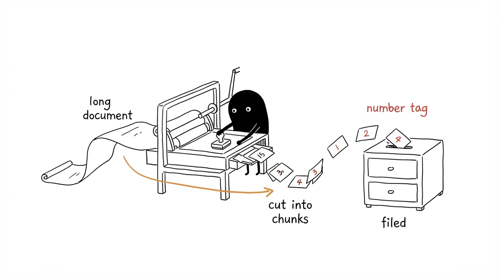
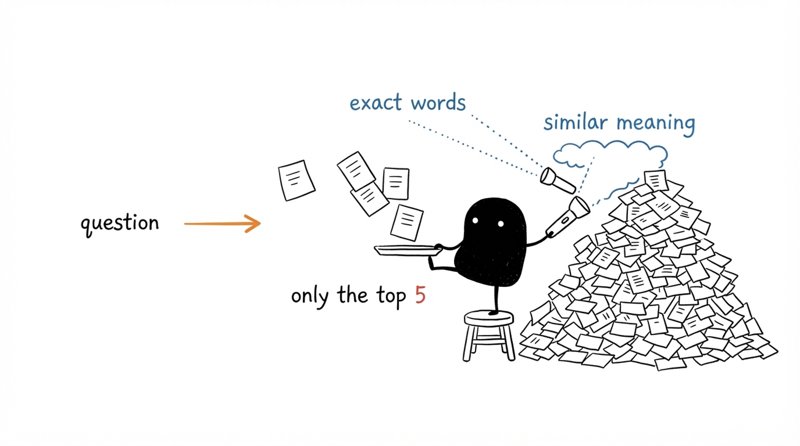
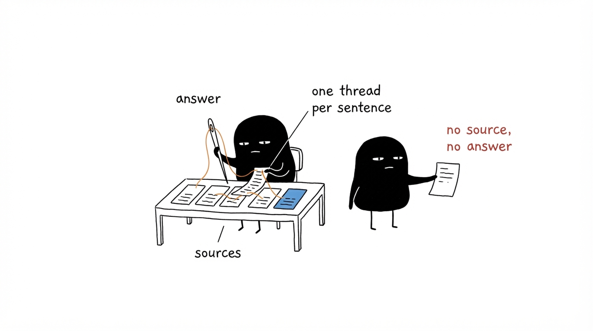
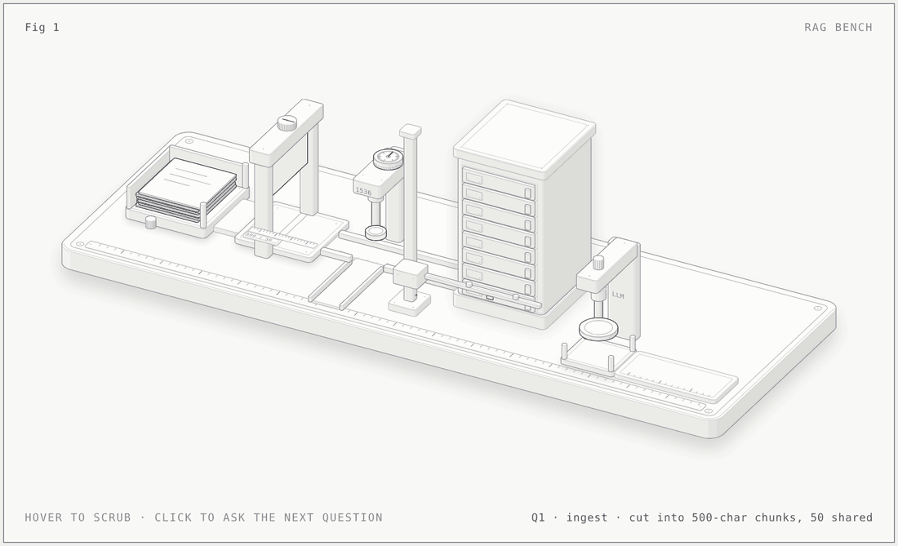

<div align="center">

# Azure AI RAG System

**Ask questions about your own documents. Get answers that cite their source.**

Hybrid search (keywords + vectors) on Azure AI Search, answers from Azure OpenAI, documents in Azure Blob Storage.

   

[Quick start](#quick-start) · [How it works](#how-it-works-start-to-finish) · [Configuration](#configuration) · [API](#api-usage) · [Limitations](#limitations)

</div>

---

## The problem and the approach

A language model on its own does not know your company's documents, so it may answer confidently and wrongly.

This project keeps **knowledge** and **reasoning** apart:

1. Your documents are split into chunks and stored in **Azure AI Search**.
2. For each question, the search service finds the few chunks that best match it.
3. Only those chunks are sent to **Azure OpenAI**, with an instruction to answer from them alone, or to say it doesn't have enough information.
4. The answer comes back with the source file (and page, for PDFs) of every chunk used.

> **What this does and does not guarantee.** The prompt tells the model to use only the retrieved text, and the temperature is low (0.1), which makes invented answers much less likely. It does not make them impossible: the model can still misread a chunk, and retrieval can miss the right one. Check the cited sources for anything important.

Because documents stay in your own Azure resources, your data is not sent to a third-party service beyond Azure. Check your tenant's Azure OpenAI data-handling and retention settings against your own policy; this repo does not configure them.

## The three ideas, illustrated

<p align="center">
  <br>
  <sub><b>1 · Ingest.</b> A long document is cut into chunks, each chunk gets a number tag (its vector), and all are filed in the search index.</sub>
</p>

<p align="center">
  <br>
  <sub><b>2 · Retrieve.</b> The question searches the pile two ways at once, by exact words and by similar meaning, and only the top 5 chunks come back.</sub>
</p>

<p align="center">
  <br>
  <sub><b>3 · Answer.</b> The answer is built only from the retrieved sources. If the sources do not contain it, the system says so instead of guessing.</sub>
</p>

## The whole system in one picture

<p align="center">
  
</p>

The pipeline drawn as a machine on a bench, left to right. Every part is one step of the code:

| On the bench | In the pipeline | Code |
|---|---|---|
| Stack of documents | Your PDF, DOCX and TXT files | `document_processor.load_document()` |
| Guillotine with a ruler plate marked 500 and 50 | Chunks of 500 characters, 50 shared with the next chunk | `document_processor.chunk_text()` |
| Belt, stamp and dial marked `1536` | Each chunk becomes a vector of 1536 numbers | `azure_openai.get_embeddings_batch()` |
| Eight-drawer cabinet | The Azure AI Search index: one drawer per stored chunk | `search_index.index_documents()` |
| Question card down the chute | The user's question, embedded by the same stamp | `azure_openai.get_embedding()` |
| Reader bar sweeping the drawers, two bars per drawer | Hybrid search: a keyword score (upper bar) and a vector score (lower bar) for every chunk | `search_index.search()` |
| Five drawers opening one at a time | The top 5 chunks (`top_k=5`) | `RAGPipeline.query()` |
| Prompt tray with a press marked `LLM` | Rules + the 5 chunks + the question go to the chat model | `azure_openai.chat_completion()` |
| Answer card with five source tabs | The answer, plus the source file and page of each chunk used | `RAGResult.sources` |

**Try it yourself.** Open [`docs/anatomy/rag-bench-light.html`](docs/anatomy/rag-bench-light.html) in a browser (a dark version, `rag-bench.html`, sits beside it). Hover to scrub through ingest and a question, click or press `1`, `2`, `3` to ask the next of three sample questions, use the arrow keys to step. GitHub does not run HTML in a README, so the animation above is a recording of it; rebuild or edit the figure with the steps in [`docs/anatomy/README.md`](docs/anatomy/README.md).

> The chunk names and the keyword and vector scores on the bench are sample data made up for the drawing. The chunk size, overlap, vector size, hybrid search and `top_k = 5` are the project's real settings.

## How it works, start to finish

### Phase 1 · Ingest: turn documents into something searchable

Run once per document set (`pipeline.ingest(...)`).

| Step | What happens | Bench part | Code |
|---|---|---|---|
| **1. Create the index** (once) | Defines the fields (`id`, `content`, `source`, `page`, `chunk_index`) and a 1536-dimension vector field searched with HNSW. | The empty cabinet | `search_index.create_index()` via `pipeline.setup()` |
| **2. Back up originals** (optional) | Copies the files to a Blob container. Search does not read from Blob; this is storage only. | not drawn | `blob_storage.upload_directory()` |
| **3. Load text** | Reads `.txt`, `.pdf` (page by page) and `.docx`. | Document stack | `document_processor.load_document()` |
| **4. Chunk** | Splits on blank lines, then sentences for long paragraphs, then merges pieces up to **500 characters** with a **50-character** overlap, so a fact is less likely to be cut in half. | Guillotine | `document_processor.chunk_text()` |
| **5. Embed** | Each chunk becomes a vector with `text-embedding-3-small`. Chunks with similar meaning get similar vectors. | Stamp and dial | `azure_openai.get_embeddings_batch()` |
| **6. Index** | Text and vector are stored together, so one query can use both. | A drawer per chunk | `search_index.index_documents()` |

### Phase 2 · Ask: find the evidence, then answer

Run for every question (`pipeline.query(...)`).

| Step | What happens | Bench part | Why it matters |
|---|---|---|---|
| **1. Embed the question** | Same embedding model as ingestion. | Question card under the stamp | Question and chunks must live in the same "meaning space" to be comparable. |
| **2. Hybrid search** | One request carries both a keyword query (`search_text`) and a vector query. Azure AI Search runs both and merges the rankings. | Reader bar, two bars per drawer | Keywords catch exact terms such as names and codes; vectors catch paraphrases. Together they miss less than either alone. |
| **3. Take the top 5** | Default `top_k=5`, adjustable per call and in the web UI. | Five drawers open | More chunks give more context but more noise and cost. |
| **4. Assemble the prompt** | Each chunk is labelled `[Source: file, Page n]` and joined with `---` separators. | Prompt tray | The model can cite what it read. |
| **5. Generate** | `gpt-4o-mini`, temperature 0.1, max 1024 tokens. The rules say: use only the context; if the answer is not there, say "I don't have enough information to answer this."; be concise; cite the document. If search returns nothing, the pipeline answers "I couldn't find any relevant information in the indexed documents." without calling the model. | Press marked `LLM` | Keeps answers grounded and repeatable. |
| **6. Return** | `RAGResult` holds the question, the answer and the source chunks. | Answer card with source tabs | Every answer can be checked against its evidence. |

## Azure services used

| Service | Role in this project | Tier used in the guide |
|---|---|---|
| **Azure OpenAI** | Embeddings (`text-embedding-3-small`) and chat (`gpt-4o-mini`) | Standard S0 |
| **Azure AI Search** | Stores chunks; runs hybrid keyword + vector search | Free or Basic |
| **Azure Blob Storage** | Optional copy of the original documents | Standard LRS |
| **Azure AI Foundry** | Where you organise the resources | n/a |

Pricing and free-tier limits change; check the Azure pricing pages before relying on them.

## Quick start

**1. Create the Azure resources** by following [SETUP_GUIDE.md](SETUP_GUIDE.md).

**2. Install locally**

```bash
git clone https://github.com/designer-coderajay/azure-ai-rag-system.git
cd azure-ai-rag-system
python -m venv venv
source venv/bin/activate          # Windows: venv\Scripts\activate
pip install -r requirements.txt
cp .env.example .env              # then fill in your Azure values
```

**3. Run the command-line demo** (creates the index, ingests sample documents, asks questions)

```bash
python demo.py
```

**4. Or use the web interface**

```bash
streamlit run app.py
```

In the sidebar: **Setup Index** once, then upload files and press **Ingest Files** (or ingest the built-in samples), then ask questions in the main panel. A separate search box shows raw search results without calling the chat model.

## Configuration

Set these in `.env` (template: `.env.example`). Never commit `.env`.

| Variable | Meaning | Default in code |
|---|---|---|
| `AZURE_OPENAI_ENDPOINT` | Your Azure OpenAI resource URL | none |
| `AZURE_OPENAI_KEY` | Its key | none |
| `AZURE_OPENAI_API_VERSION` | API version | `2024-06-01` |
| `AZURE_OPENAI_CHAT_DEPLOYMENT` | Name you gave the chat deployment | `gpt-4o-mini` |
| `AZURE_OPENAI_EMBEDDING_DEPLOYMENT` | Name you gave the embedding deployment | `text-embedding-3-small` |
| `AZURE_SEARCH_ENDPOINT` | Your Search service URL | none |
| `AZURE_SEARCH_KEY` | Admin key | none |
| `AZURE_SEARCH_INDEX` | Index name | `rag-index` |
| `AZURE_STORAGE_CONNECTION_STRING` | Blob connection string | none |
| `AZURE_STORAGE_CONTAINER` | Container name | `documents` |

The index vector field is fixed at 1536 dimensions. If you switch to an embedding model with a different size, change `vector_search_dimensions` in `src/search_index.py` and recreate the index.

## Project structure

```
azure-ai-rag-system/
├── app.py                    # Streamlit web interface
├── demo.py                   # Command-line walkthrough (run this first)
├── requirements.txt          # Python dependencies
├── .env.example              # Template for Azure credentials
├── SETUP_GUIDE.md            # Step-by-step Azure Portal instructions
├── docs/
│   ├── illustrations/        # Three hand-drawn walkthrough images used above
│   └── anatomy/              # The interactive bench figure (HTML, GIF, PNG) and its build files
└── src/
    ├── config.py             # Loads settings from .env
    ├── document_processor.py # Load PDF/DOCX/TXT and split into chunks
    ├── azure_openai.py       # Embeddings, chat, streaming chat, the system prompt
    ├── search_index.py       # Create index, upload chunks, hybrid and vector search
    ├── blob_storage.py       # Upload, list, download, delete files in Blob
    └── pipeline.py           # RAGPipeline: ties everything together
```

Sample documents are generated at run time under `data/sample_docs/` by `demo.py` and `app.py`; that folder is not in the repository.

## API usage

```python
from src.pipeline import RAGPipeline

pipeline = RAGPipeline(top_k=5)
pipeline.setup()                                   # create the search index (once)
pipeline.ingest("./documents/")                    # load, chunk, embed, index
pipeline.ingest("./documents/", upload_to_blob=True)   # also copy originals to Blob

result = pipeline.query("What is the remote work policy?")
print(result.answer)
for s in result.sources:
    print(s["source"], s.get("page"))

for token in pipeline.query_stream("Summarise the leave policy"):
    print(token, end="", flush=True)               # token-by-token output

hits = pipeline.search_only("remote work", top_k=10)   # retrieval only, no chat model
```

`query_stream` is available in the Python API. The bundled Streamlit app calls `query`, so it shows the full answer at once.

## Limitations

- **Chunking is character-based.** Chunks target 500 characters, not tokens, and the overlap is the last 50 characters of the previous chunk, which can start mid-word. Very long tables and scanned PDFs (no text layer) are not handled well.
- **No re-ranking and no semantic ranker.** Results are the search service's merged keyword and vector ranking only.
- **Answer quality depends on retrieval.** If the right chunk is not in the top 5, the model cannot use it. Raise `top_k` or tune the chunk size.
- **Keys, not managed identity.** The code reads API keys from `.env`. `azure-identity` is in `requirements.txt`, but the shown code authenticates with keys; for production, consider managed identities and a secret store.
- **No access control per document.** Anyone who can query the index can retrieve any chunk in it.
- **Not tested here.** This README was checked against the source code, not by running the pipeline against live Azure resources.

## Skills demonstrated

Azure OpenAI deployment · Azure AI Search index design with vector search · hybrid (BM25 + vector) retrieval · Azure Blob Storage integration · RAG prompt design · streaming responses · configuration management

## License

MIT
